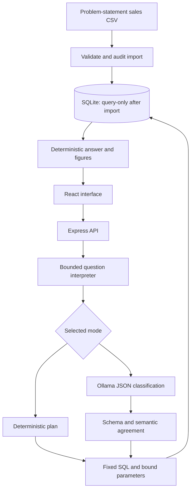

# Architecture

## Why these choices

React renders the form, examples, import audit, charts and evidence. Express handles JSON validation and errors. SQLite provides a real query engine without a separate service. Built-in `node:sqlite` avoids a native npm database dependency; modern Node is required. Monetary values are stored as integer minor units. SQL is chosen from server-owned templates; month values use placeholders. Only whitelisted enum values choose a grouping column. The client never supplies query text. `PRAGMA query_only` adds database-level protection.

The model is an interpreter, not a calculator. It sees only a question and the classification instruction, not transaction data. The API calculates narrative text from actual query rows. Its JSON output cannot alter the SQL or assumptions. The same result includes a table and SQL for reviewer inspection.

## Storage

`sales(id, order_date, product, category, region, channel, quantity, gross_cents, discount_cents, revenue_cents, status)`. IDs are unique; ISO date strings sort chronologically. A date index supports date-based extensions. This prototype uses synchronous queries because there are only 49 stored rows. The audit report lives alongside the database in server memory. Each start deterministically reloads the CSV; there is no writable analytics endpoint.

## Error boundaries

CSV structural errors fail startup rather than partially guessing columns. Per-row errors are recorded in the audit and skipped. API body validation precedes interpretation. Unsupported intent, filters, unknown comparison months and inconsistent LLM output are rejected. Ollama has a 20-second timeout. Server internals are not exposed in unexpected-error responses.
